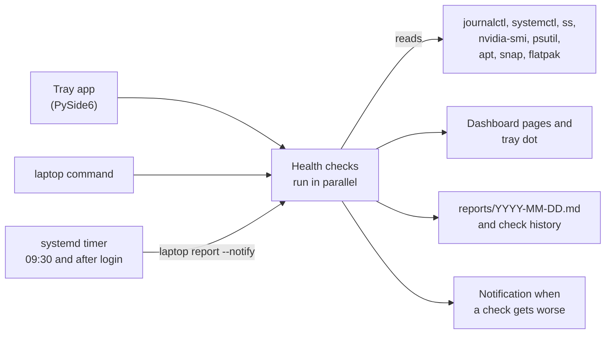

<div align="center">


# Laptop Doctor

**Health checks, a live system monitor, cleanup, crash triage, update tracking and daily reports for an Ubuntu laptop, read-only by default.**

[](https://github.com/AbdelRahman-Madboly/laptop-doctor/actions/workflows/ci.yml)


[How it works](#how-it-works) · [Install](#install) · [The app](#the-app) · [Terminal](#terminal) · [What it does not do](#what-it-does-not-do)

</div>

## Why Laptop Doctor

A laptop that freezes, fills its disk or loses its GPU driver rarely says why, and the answers are
spread across the journal, systemd, `nvidia-smi` and a handful of package managers. Laptop Doctor
gathers them into one place: a desktop app that lives in the tray and keeps checking in the
background, plus the `laptop` command for the terminal. It was written on a Dell G15 5530 (Ubuntu
24.04, NVIDIA GPU).

## Highlights

- **Read-only by default.** The only things it changes are user-level caches you tick on the
  Optimize page (or `laptop clean --apply`) and processes you end from the Monitor page. Root-level
  fixes are shown as commands for you to run, never run for you.
- **Health at a glance.** A health score, what needs attention with the fix, and live CPU, RAM,
  GPU, temperature, disk and battery tiles.
- **Crash triage.** Boots, crash reports, OOM kills, GPU Xid, lockups, previous-boot errors and
  segfaults over 1 to 30 days.
- **Lives in the tray.** The tray dot is green, amber or red for the last check, and a notification
  appears only when a check gets worse than on the previous run.
- **Daily reports.** A systemd user timer writes a Markdown report every day, even when the app is
  not running.
- **Same checks in the terminal.** `laptop check` prints a one-screen OK/WARN/FAIL summary.

## How it works



Every check only reads. Changes happen only when you ask for them: clearing the user-level caches
you ticked, or ending a process from the Monitor page.

## Status

v2.0.0 plus the unreleased changes in [CHANGELOG.md](CHANGELOG.md). Built as a personal tool and used
daily on one laptop, where the tray app, the `laptop` command and the daily timer run; 45 tests pass
(`uv run pytest`). Other hardware should work for the generic checks, but the GPU checks assume an
NVIDIA card with `nvidia-smi` and the thresholds were tuned on one machine.

## Install

```
packaging/install.sh           # app grid entry, desktop icon, start in the tray at login, `laptop` on PATH
packaging/install.sh --remove  # undo (settings and reports are kept)
```

Needs `uv`. On X11 Qt needs `libxcb-cursor0`; if it is missing the installer fetches a private copy
into `.venv/extra-lib` without root (the system-wide fix is `sudo apt install libxcb-cursor0`). The
tray icon uses the AppIndicator extension that Ubuntu ships enabled.

## The app

| Page | What it shows |
|---|---|
| Overview | health score, what needs attention with the fix, live CPU/RAM/GPU/temp/disk/battery tiles, network, score trend |
| Monitor | CPU history and per-thread bars, RAM and swap, NVIDIA load/VRAM/power, disk and network rates, temperatures, process table with End task / Force kill |
| Health | every check as a card: status, finding, copyable fix |
| Optimize | reclaimable space (safe to clear / review by hand / needs sudo), largest folders in home, memory hogs |
| Crashes | boots, crash reports, OOM kills, GPU Xid, lockups, previous-boot errors, segfaults (1 to 30 days) |
| Updates | apt, snap, flatpak, toolchains, npm globals |
| Device | model, BIOS, OS, CPU, RAM, GPUs, battery wear, disks and partitions, network interfaces |
| Reports | the daily Markdown reports, rendered; generate one now |
| Settings | start at login, close to tray, check interval, notifications, daily report, dark/light |

Closing the window keeps it in the tray. The tray icon's dot is green, amber or red for the last
check; its menu has run check, quick clean, write report and quit. A notification appears only when
a check gets worse than on the previous run. Shortcuts: `Ctrl+1`..`Ctrl+9` pages, `Ctrl+R` run
checks, `Ctrl+Q` quit.

## Terminal

```
laptop                  open the dashboard (laptop gui --background starts in the tray)
laptop check            one-screen OK/WARN/FAIL summary
laptop crashes [days]   boots, crash files, OOM kills, GPU Xid, lockups, previous-boot errors
laptop clean [--apply]  reclaimable space; --apply clears safe user caches and idle Gradle/Kotlin daemons
laptop updates          apt, snap, flatpak, toolchains, npm globals
laptop report [--notify] writes reports/YYYY-MM-DD.md (last 30 kept, not committed)
laptop snapshot         run scan.sh from notes_dir (see Configuration)
```

`systemd/laptop-doctor.timer`, once copied with its service to `~/.config/systemd/user/` and
enabled (`systemctl --user enable --now laptop-doctor.timer`), runs
`laptop report --notify` at 09:30 and 5 minutes after login, so reports keep coming when the app is
not running. When the tray app is up it skips its own notification to avoid doubles.

## Configuration

Everything machine-specific is optional and lives in `~/.config/laptop-doctor/config.json`;
[`config.example.json`](config.example.json) shows the format. A missing key turns that feature off.

<details>
<summary>Configuration keys</summary>

| Key | What it does |
|---|---|
| `notes_dir` | folder with your machine notes and a `scan.sh` that `laptop snapshot` runs |
| `backup_unit` | systemd user unit whose last result the Backups check reports |
| `plugin_cache_root` | plugin folder of an editor or assistant tool (`installed_plugins.json` plus `cache/`); unreferenced versions are offered for cleanup |
| `review_paths` | extra `[title, path]` folders shown for review on the Optimize page, such as editor and assistant caches or model stores |
| `toolchain_versions` | extra `[name, command, args...]` rows on the Updates page |

</details>

Settings and check history live in `~/.config/laptop-doctor/`.
[`known-ports`](known-ports): services that are meant to listen on all interfaces.

## What it does not do

- It does not run anything as root. Fixes that need `sudo` are shown as commands to copy.
- It does not install updates. The Updates page lists what is pending.
- It does not delete files outside user-level caches, and only the ones ticked on the Optimize
  page or cleared by `laptop clean --apply`.
- It is written for Ubuntu with systemd and tested on one laptop with an NVIDIA GPU. It has no
  support for other distributions, AMD or Intel GPU monitoring, or macOS.
- It does not upload anything. Reports stay in `reports/` and are not committed.

## Tests

```
uv run pytest
```

Most checks are tested with canned command output, so they pass on any machine. One test runs
every check against the real machine and only asserts that each returns a known status. CI runs the
same tests on every push to `main` ([`.github/workflows/ci.yml`](.github/workflows/ci.yml)).

## Layout

```
laptop_doctor/
  checks.py    the health checks and thresholds
  metrics.py   live sampler and process list
  sysinfo.py   device facts
  cleanup.py   reclaimable space and the safe cleanup
  triage.py    crash triage and update listing
  report.py    Markdown reports, check history, notifications
  cli.py       the `laptop` command
  ui/          PySide6 app: app.py (window + tray), state.py, widgets.py, theme.py, pages/
assets/        app and tray icons (SVG)
packaging/     install.sh, icon renderer
systemd/       daily report service and timer
tests/         uv run pytest
```

## License

MIT, see [LICENSE](LICENSE).

## Author

Designed and built by **Abdel Rahman Mohamad EL-Sayed** ([@AbdelRahman-Madboly](https://github.com/AbdelRahman-Madboly)).
